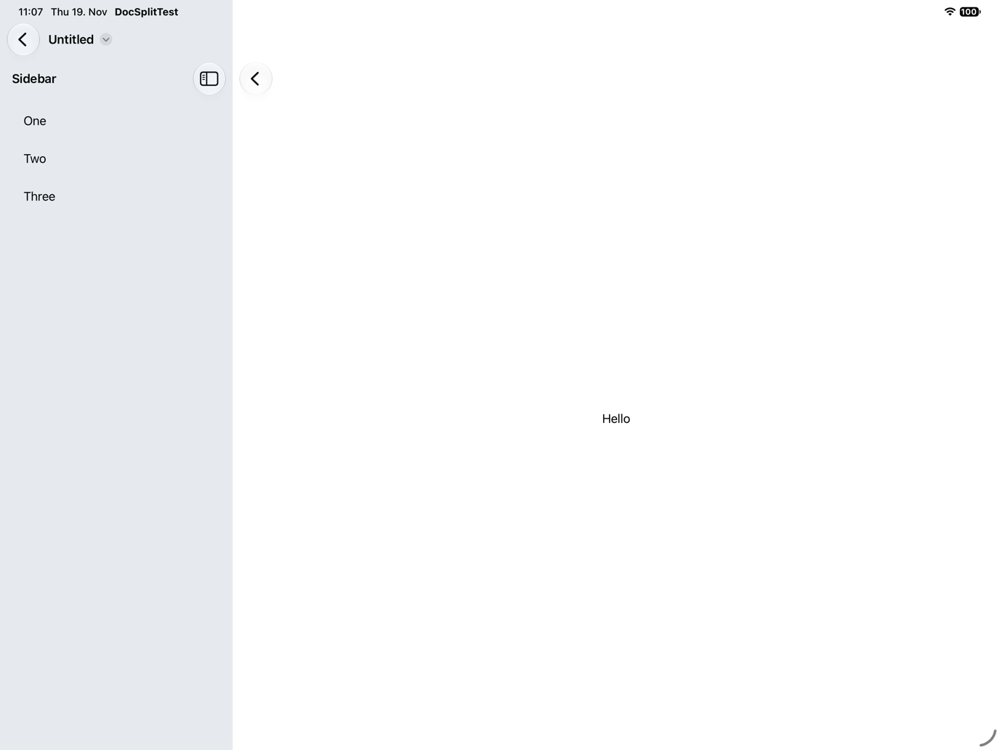
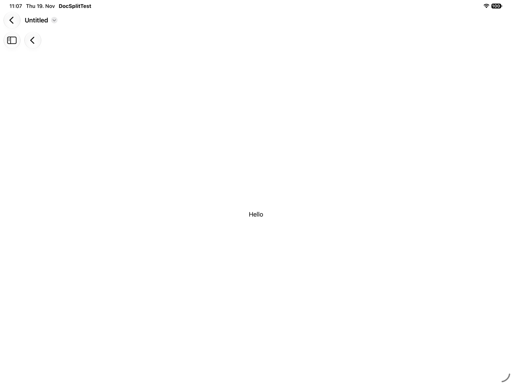

# DocumentGroup + NavigationSplitView shows two navigation bars on iPadOS

A minimal reproduction: a SwiftUI document-based app whose document view is a
`NavigationSplitView` gets a second, redundant navigation bar on iPad.

## Environment

- Xcode 27.2, iOS 27.2 SDK
- iPad Pro 13-inch (M5) simulator, iOS 27.2 (24B8117); also seen on a real iPad
- Landscape (also happens in portrait)

## The code

The whole app is [`DocSplitTest/DocSplitTestApp.swift`](DocSplitTest/DocSplitTestApp.swift).
The document view is nothing but:

```swift
NavigationSplitView {
    List(["One", "Two", "Three"], id: \.self) { item in
        Text(item)
    }
    .navigationTitle("Sidebar")
} detail: {
    Text(text)
}
```

It contains no `NavigationStack`, no toolbar items and no other modifiers.

The app can use either document API:

- default: the iOS 27 `Document` protocol (`DocumentGroup { document in … } makeDocument: { … }`)
- launch argument `-classic`: `FileDocument` (`DocumentGroup(newDocument:)`)

Both show the bug.

## Steps to reproduce

1. Build and run the `DocSplitTest` scheme on an iPad (simulator or device) in landscape.
2. Open a document from the document browser.
3. Look at the top of the window, then hide the sidebar with its toggle button.

## Expected

One row of navigation bars. The split view's column bars show the document's back button
and title menu, as with any `NavigationSplitView`.

## Actual

`DocumentGroup` adds its own full-width navigation bar above the split view, with a
back button and the "Untitled ⌄" title menu. The split view's column bars sit
below it, and the detail column's bar has a second back button.

- With the sidebar shown, the document bar's items are only visible over the sidebar column,
  so the sidebar has two stacked bars ("Untitled ⌄" above "Sidebar"), and an empty strip
  runs across the top of the detail column.
- With the sidebar hidden, there are two full-width rows: back + "Untitled ⌄", then the
  sidebar toggle + another back button.

All content moves down by the height of the extra bar (54 pt).

| Sidebar shown | Sidebar hidden |
| --- | --- |
|  |  |

## Tried without success

In a larger app with the same structure:

- `.toolbar(.hidden, for: .navigationBar)` on the `NavigationSplitView`
- the same modifier on the document group's root view
- with and without `.toolbarRole(.editor)`
- with and without an `.inspector`

The extra bar stays in every case. There's no public API that hides it.

## Note on the test app

"Create Document" in the browser fails with "Unable to Import Document
(com.apple.DocumentManager error 1)" in this test app, probably because of its bare-bones
plain-text document type setup. It still creates the file, which can then be opened from
Recents. This is unrelated to the navigation bar issue; the larger app creates documents
normally and shows the same double bar.
